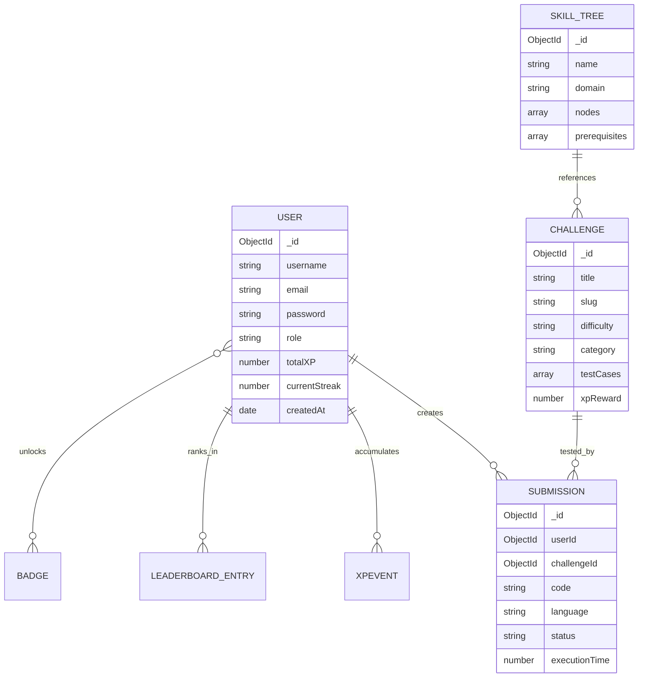

<div align="center">

# ⚔️ DevArena

### *Gamified Skill Building & Multi-Role Coding Platform*

An enterprise-grade, high-performance web platform that turns algorithmic problem-solving, system design, and technical assessment into an engaging, multi-role developer ecosystem.

[](https://devarena-client.vercel.app/)
[](https://github.com/harshadbhaigohil40-oss/devarena-)
[](https://opensource.org/licenses/MIT)
[](https://devarena-client.vercel.app/)

<p align="center">
  
  
  
  
  
  
  
  
</p>

### 🔗 Quick Links
[🌐 **Live Demo**](https://devarena-client.vercel.app/) &nbsp;•&nbsp;
[📁 **GitHub Repository**](https://github.com/harshadbhaigohil40-oss/devarena-) &nbsp;•&nbsp;
[🐛 **Report an Issue**](https://github.com/harshadbhaigohil40-oss/devarena-/issues) &nbsp;•&nbsp;
[⭐️ **Star on GitHub**](https://github.com/harshadbhaigohil40-oss/devarena-)

---

</div>

> [!IMPORTANT]
> **Code Execution Security Architecture**: In-process or host-level code execution is **NOT** a safe multi-tenant security boundary. For production multi-tenant environments, configuring `RUNNER_URL` to route execution through an isolated sandbox runner service (such as Judge0 or container microVMs) is recommended.
>
> **Remote Runner Adapter Contract (`/api/v1/execute`):**
> When `RUNNER_URL` is set, DevArena sends execution payloads to `POST ${RUNNER_URL}/api/v1/execute` with `{ code, language, testCases: [{ index, input, expectedOutput, isHidden }], timeout }` and optional `Authorization: Bearer <RUNNER_API_KEY>`.

---

## 📖 Table of Contents

- [Overview](#-overview)
- [Three Distinct Platform Experiences](#-three-distinct-platform-experiences)
  - [1. Developer Experience](#1-developer-experience)
  - [2. Recruiter Experience](#2-recruiter-experience)
  - [3. Admin Experience](#3-admin-experience)
- [Built-in Developer Utilities](#-built-in-developer-utilities)
- [System Architecture](#-system-architecture)
- [Tech Stack](#-tech-stack)
- [Quick Start / Installation Guide](#-quick-start--installation-guide)
- [Environment Variables Guide](#-environment-variables-guide)
- [Database Schema & Architecture](#-database-schema--architecture)
- [Project Directory Hierarchy](#-project-directory-hierarchy)
- [API Endpoints Reference](#-api-endpoints-reference)
- [License](#-license)

---

## 🌟 Overview

**DevArena** is a production-ready, full-stack platform crafted to solve a real gap in technical learning and hiring: traditional competitive programming platforms feel dry and disconnected, while recruiters lack verified, transparent skill telemetry.

DevArena bridges this divide by delivering an integrated ecosystem combining **live sandboxed code execution**, **RPG-style skill trees**, **AI mentorship**, **recruiter analytics**, and **administrative challenge moderation**.

---

## 🎭 Three Distinct Platform Experiences

### 1. Developer Experience
- **Interactive Code Arena:** In-browser code editor supporting multiple programming languages (JavaScript, Python, C++, Java) with instant test-case verification and error stack inspection.
- **Dynamic Skill Trees:** Prerequisite-based visual roadmaps spanning Data Structures, Algorithms, Frontend, Backend, and System Design. Unlock downstream branches by completing challenge milestones.
- **AI Mentorship (Gemini AI):** Contextual coding hints, edge-case guidance, and Big-O complexity analysis ($O(N)$, $O(\log N)$) without giving away the answer outright.
- **Gamified Progression:** XP rewards weighted by difficulty tiers (Easy, Medium, Hard, Legendary), daily streak multipliers, global percentile ranking, and collectible achievement badges.
- **Real-Time Community Chat:** Instant messaging channels powered by Socket.io for peer discussions and candidate-recruiter outreach.

### 2. Recruiter Experience
- **Talent Discovery Engine:** Search and filter developers by specific technical skills, experience tier, completed nodes, and percentile ranking.
- **Candidate Analytics:** Interactive visualizations (powered by Recharts) showing verified candidate competency distributions across domains.
- **Direct Candidate Outreach:** Message verified candidates directly through real-time communication modal dialogs.

### 3. Admin Experience
- **Challenge Lifecycle Management:** Create, edit, and validate technical challenges with both public and hidden test cases.
- **AI-Powered Challenge Generation & Quality Review:** Auto-generate problem drafts and review submissions with automated quality badges (Excellent, Good, Average, Poor).
- **Platform Analytics:** Real-time metrics on submission volumes, pass/fail ratios, and platform activity.

---

## 🛠️ Built-in Developer Utilities

DevArena includes client-side daily engineering utilities so developers never need to leave the tab:

- 🔍 **JSON Formatter & Validator:** Syntax highlighting, 2/4-space beautification, and RFC-compliant error tracking.
- 🔐 **Base64 Encoder / Decoder:** Instant dual-way encoding for payloads, assets, and headers.
- 🎫 **JWT Token Inspector:** Decodes and inspects headers, claims, and expiration timestamps securely on the client.
- 🎯 **Regex Tester & Playground:** Live pattern evaluation, capture group detection, and flag switching.

---

## 🏛 System Architecture

```
┌────────────────────────────────────────────────────────────────────────┐
│                        CLIENT LAYER (Vercel)                           │
│  React 18 + Vite • Tailwind CSS • Framer Motion • Zustand Store       │
│  Monaco Editor • Recharts • Socket.io Client • Developer Utilities    │
└───────────────────────────────────┬────────────────────────────────────┘
                                    │
                              HTTPS / REST / WSS
                                    │
┌───────────────────────────────────▼────────────────────────────────────┐
│                       API GATEWAY & BACKEND                            │
│  Node.js + Express.js REST API + Socket.io Server                     │
│  ├─ Security Middleware (Helmet, CORS, Rate Limiting, Mongo Sanitize)  │
│  ├─ Authentication Guard (JWT & Role-Based Access: User/Recruiter/Admin)│
│  ├─ AI Service Adapter (Google Gemini AI Key Manager & Failover)      │
│  └─ Code Execution Runner (Sandboxed process isolation & timeouts)    │
└───────────────────────────────────┬────────────────────────────────────┘
                                    │
                               Mongoose ODM
                                    │
┌───────────────────────────────────▼────────────────────────────────────┐
│                        DATA PERSISTENCE LAYER                          │
│  MongoDB Atlas (Cloud Managed Database)                                │
│  ├─ Users & Auth Credentials (Bcrypt Hashed)                           │
│  ├─ Challenges, Test Cases & Submissions History                       │
│  ├─ Skill Trees, Badges & XP Audit Ledgers                             │
│  └─ Real-Time Messages & Recruiter Bookmarks                           │
└────────────────────────────────────────────────────────────────────────┘
```

---

## 🛠 Tech Stack

| Layer | Technology | Purpose |
| :--- | :--- | :--- |
| **Frontend Framework** | **React.js 18 (Vite)** | Modular component architecture with fast hot-module replacement |
| **Styling** | **Tailwind CSS** | Responsive styling, dark/light theme tokens, and custom UI components |
| **Animations** | **Framer Motion** | Fluid transitions, animated skill tree nodes, and modal state physics |
| **Data Visualization** | **Recharts** | Interactive skill distributions, analytics charts, and submission trends |
| **Real-Time Layer** | **Socket.io** | Low-latency bi-directional messaging and notification events |
| **Backend Runtime** | **Node.js (v18+)** | Asynchronous, event-driven server runtime |
| **Web Framework** | **Express.js** | Modular REST API routing and middleware pipelines |
| **Authentication** | **JWT & Bcrypt** | Stateless session tokens, role-based route protection, and hashed credentials |
| **Database** | **MongoDB (Mongoose)** | High-availability document storage with indexed schemas |
| **AI Integration** | **Google Gemini AI** | Dynamic problem hints, code reviews, and challenge quality assessments |
| **Hosting** | **Vercel & Cloud** | Edge deployment for frontend client with automatic branch CI/CD |

---

## 🚀 Quick Start / Installation Guide

### Prerequisites
- [Node.js](https://nodejs.org/) (Version **18.x** or higher)
- [npm](https://www.npmjs.com/) (Version **9.x** or higher)
- [Git](https://git-scm.com/)
- [MongoDB](https://www.mongodb.com/) (Local instance or MongoDB Atlas cloud connection URI)

---

### Step 1: Clone the Repository
```bash
git clone https://github.com/harshadbhaigohil40-oss/devarena-.git
cd devarena-
```

### Step 2: Install Dependencies
DevArena uses monorepo workspaces to install client and server packages with a single command:
```bash
npm install
```

### Step 3: Configure Environment Variables
Copy `.env.example` into `.env` at the root directory:
```bash
# Windows (PowerShell):
copy .env.example .env

# Linux / macOS:
cp .env.example .env
```
Fill in your MongoDB connection string and API keys (see [Environment Variables Guide](#-environment-variables-guide)).

### Step 4: Seed Database (Optional)
Populate your database with default challenges, badges, and skill tree nodes:
```bash
npm run seed
```

### Step 5: Start Development Servers
Run both client and backend servers concurrently:
```bash
npm run dev
```

| Application | Address |
| :--- | :--- |
| **Frontend Client (Vite)** | `http://localhost:5173` |
| **Backend API (Express)** | `http://localhost:5000` |
| **API Health Check** | `http://localhost:5000/api/health` |

---

## 🔐 Environment Variables Guide

```env
# Server Configuration
PORT=5000
NODE_ENV=development
CLIENT_URL=http://localhost:5173

# Database Connection
MONGODB_URI=mongodb://localhost:27017/devarena

# Security & Authentication
JWT_SECRET=your_super_secret_jwt_key_here
JWT_EXPIRES_IN=7d

# Google Gemini AI Integration
GEMINI_API_KEY=your-gemini-api-key-here
GEMINI_API_KEYS=key1,key2,key3 # Optional key rotation

# Admin Seed Account
ADMIN_EMAIL=admin@devarena.com
ADMIN_PASSWORD=AdminSecurePassword123!
```

---

## 🗄 Database Schema & Architecture



---

## 📁 Project Directory Hierarchy

```text
devarena/
├── client/                     # Frontend Single Page Application (React + Vite)
│   ├── public/                 # Static assets, favicon, SVGs
│   ├── src/
│   │   ├── components/         # Reusable design system UI components
│   │   │   ├── charts/         # Analytics and progress charts (Recharts)
│   │   │   ├── layout/         # Navigation, Sidebar, Shell, ErrorBoundary
│   │   │   ├── routing/        # ProtectedRoute & RoleRoute guards
│   │   │   ├── skeletons/      # Loading placeholder skeletons
│   │   │   └── ui/             # Buttons, Inputs, Dialogs, Badges
│   │   ├── context/            # AuthContext, ThemeContext, SocketContext
│   │   ├── features/           # Modular feature domains
│   │   │   ├── ai/             # AI Advisor & hint drawer
│   │   │   ├── auth/           # Login, Register, Forgot/Reset Password
│   │   │   ├── challenges/     # Code Editor, Runner, Test Case Results
│   │   │   ├── chat/           # Real-time ChatModal with Socket.io
│   │   │   ├── recruiter/      # RecruiterDashboard & talent search
│   │   │   └── settings/       # User profile, theme, and security settings
│   │   ├── pages/              # Primary route views (Landing, Dashboard, DSA, Admin)
│   │   ├── services/           # Axios API abstraction layers
│   │   ├── utils/              # Developer tools (JSON, Base64, JWT, Regex)
│   │   ├── App.jsx             # React Router route definitions
│   │   └── main.jsx            # React 18 DOM mount point
│   ├── tailwind.config.js      # Custom theme, typography & animation rules
│   └── vite.config.js          # Vite build optimizations & chunk splitting
│
├── server/                     # Backend API & Server Runtime (Node.js + Express)
│   ├── config/                 # DB connection, Gemini AI manager, Admin seed
│   ├── controllers/            # Core business logic & request handlers
│   │   ├── adminChallengeController.js  # Challenge CRUD & moderation
│   │   ├── aiController.js              # Gemini AI hints & code reviews
│   │   ├── authController.js            # JWT login, signup, password resets
│   │   ├── challengeController.js       # Problem retrieval & filtering
│   │   ├── leaderboardController.js     # Percentile calculation & rankings
│   │   ├── recruiterController.js       # Talent pool search & candidate metrics
│   │   ├── skillTreeController.js       # Node unlock & progress tracking
│   │   └── submissionController.js      # Code evaluation & XP awards
│   ├── middleware/             # Auth verification, role checks, rate limiting
│   ├── models/                 # Mongoose schemas (User, Challenge, Submission, etc.)
│   ├── routes/                 # Express API route endpoints
│   ├── services/               # Badge, XP, Gemini rotation, Runner services
│   ├── socket/                 # Socket.io real-time connection handlers
│   └── server.js               # Application bootstrapper & listener
│
├── shared/                     # Universal constants & validation schemas
├── package.json                # Root monorepo workspace configuration
└── README.md                   # Platform documentation
```

---

## 📡 API Endpoints Reference

| Method | Endpoint | Description | Access |
| :--- | :--- | :--- | :--- |
| `POST` | `/api/auth/register` | Register a new user account | Public |
| `POST` | `/api/auth/login` | Authenticate user & issue JWT token | Public |
| `GET` | `/api/auth/me` | Fetch authenticated user profile & XP stats | Authenticated |
| `GET` | `/api/challenges` | List challenges with difficulty/category filters | Public |
| `GET` | `/api/challenges/:slug` | Retrieve single challenge details & test cases | Public |
| `POST` | `/api/submissions` | Submit code for sandboxed test validation | Authenticated |
| `GET` | `/api/leaderboard` | Get paginated global percentile rankings | Public |
| `GET` | `/api/skilltree` | Fetch complete interactive skill progression tree | Authenticated |
| `POST` | `/api/ai/hint` | Request AI-generated hint for current challenge | Authenticated |
| `POST` | `/api/ai/review` | Generate comprehensive AI code complexity review | Authenticated |
| `GET` | `/api/recruiter/talent` | Search and filter developers by skills and tiers | Recruiter |
| `GET` | `/api/recruiter/analytics` | Retrieve candidate pool statistics | Recruiter |
| `GET` | `/api/admin/challenges` | List and filter challenges for review | Admin |
| `POST` | `/api/admin/challenges` | Create or approve new coding challenge | Admin |

---

## 📄 License

Distributed under the **MIT License**. See `LICENSE` for more information.

---

<div align="center">

**DevArena** — *Empowering developers, recruiters, and technical educators through gamified excellence.*

Created by [Harshad Gohil](https://github.com/harshadbhaigohil40-oss) &nbsp;•&nbsp; [Live Platform](https://devarena-client.vercel.app/)

</div>
