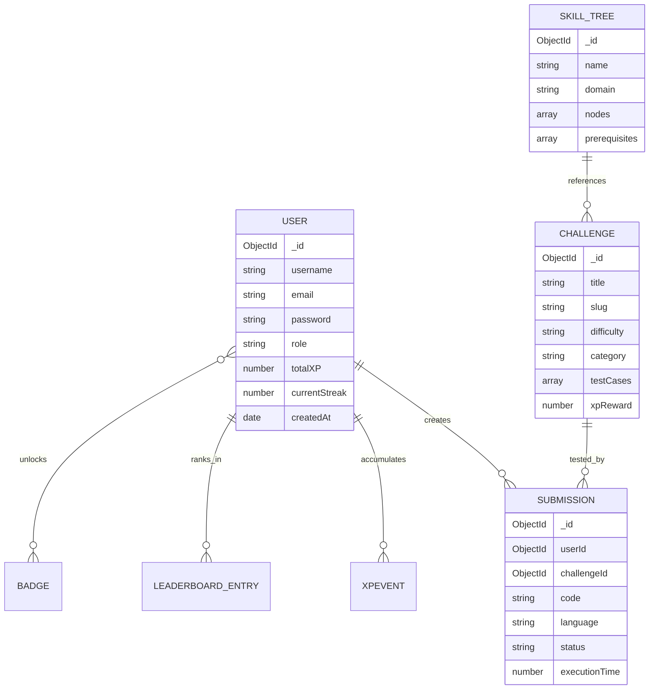

<div align="center">

# ⚔️ DevArena

### *Gamified Developer Skill Building & Coding Platform*

An enterprise-grade, high-performance web platform that turns algorithmic problem-solving, system design, and technical interview preparation into an engaging, gamified adventure.

[](https://devarena-client.vercel.app/)
[](https://opensource.org/licenses/MIT)
[](https://devarena-client.vercel.app/)

<p align="center">
  
  
  
  
  
  
  
</p>

### 🔗 Quick Links
[🌐 **Explore Live Demo**](https://devarena-client.vercel.app/) &nbsp;•&nbsp;
[🐛 **Report an Issue**](https://github.com/devarena-io/devarena/issues) &nbsp;•&nbsp;
[💡 **Request Feature**](https://github.com/devarena-io/devarena/issues) &nbsp;•&nbsp;
[⭐️ **Star on GitHub**](https://github.com/devarena-io/devarena)

---

</div>

> [!IMPORTANT]
> **Code Execution Security Architecture**: In-process or host-level code execution (even with `child_process.spawn`, `ulimit`, and AST/regex pattern filtering) is **NOT** a security boundary for untrusted code execution. For production multi-tenant environments, configuring `RUNNER_URL` to route execution through an isolated sandbox service (such as Judge0 or Piston container microVMs) is **strictly required**.
>
> **Remote Runner Adapter Contract (`/api/v1/execute`):**
> When `RUNNER_URL` is set, DevArena sends execution payloads to `POST ${RUNNER_URL}/api/v1/execute` with `{ code, language, testCases: [{ index, input, expectedOutput, isHidden }], timeout }` and optional `Authorization: Bearer <RUNNER_API_KEY>`. It expects a response schema `{ results: [{ passed: boolean, executionTime?: number, ... }] }` whose length exactly matches `testCases.length`. This is a custom DevArena adapter contract and must be adapted if integrating directly with standard Judge0 or Piston API endpoints.


## 📖 Table of Contents

- [Overview](#-overview)
- [Core Features](#-core-features)
- [System Architecture](#-system-architecture)
- [Tech Stack Overview](#-tech-stack-overview)
- [Quick Start / Installation Guide](#-quick-start--installation-guide)
- [Environment Variables (.env.example)](#-environment-variables-envexample)
- [Database Schema & Architecture](#-database-schema--architecture)
- [Project Directory Hierarchy](#-project-directory-hierarchy)
- [API Endpoints Overview](#-api-endpoints-overview)
- [Commercial Handoff & Transfer License Notice](#-commercial-handoff--transfer-license-notice)
- [Contributing](#-contributing)
- [License](#-license)

---

## 🌟 Overview

**DevArena** is a production-ready, full-stack SaaS platform crafted to elevate developer learning curves. Traditional competitive programming tools often feel dry, intimidating, and disconnected from modern engineering workflows. 

DevArena reimagines technical mastery by blending **interactive code execution**, **gamified XP progression**, **dynamic skill trees**, and **intelligent AI mentoring** into a fluid, reactive, and distraction-free user experience.

> **Target Audience:** Aspiring software engineers, interview candidates, competitive programmers, and tech recruiters looking for high-signal assessment platforms.

---

## ⚡ Core Features

DevArena delivers an expansive suite of capabilities built for engagement, performance, and deep learning:

- 🎮 **Interactive Coding Challenges & XP Gamification System**
  - Real-time in-browser code editor with multi-language execution and instant test-case evaluation.
  - Granular XP rewards, difficulty multipliers (Easy, Medium, Hard, Legendary), daily challenge streaks, and level progression mechanics.
  - Safe sandboxed runtime executing user code in isolated environments with strict execution timeouts.

- 🏆 **Percentile Leaderboards & Badge Unlocks**
  - Dynamic percentile ranking engine displaying how candidates stack up globally across the user base.
  - Tier progression (Bronze, Silver, Gold, Platinum, Diamond, Grandmaster).
  - Collectible SVG achievement badges unlocked via milestone triggers (e.g., *Speed Demon*, *Algorithm Architect*, *Clean Coder*).

- 🌳 **Dynamic Skill Trees for Algorithms & System Design**
  - Interactive visual node graph mapping engineering skills from foundational data structures (Arrays, Linked Lists, Trees, Graphs) to complex distributed systems.
  - Prerequisite unlock mechanism: complete upstream challenges to unlock advanced node specializations.
  - Real-time mastery % calculation per engineering domain.

- 🛠️ **Built-in Developer Utilities**
  - **JSON Formatter & Validator:** Instant syntax highlighting, indentation beautification, and RFC-compliant error reporting.
  - **Base64 Encoder / Decoder:** Lightning-fast dual-way encoding for payloads, assets, and authorization headers.
  - **JWT Token Decoder & Inspector:** Client-side JWT header, payload, and expiry expiration validator with cryptographic safety.
  - **Regex Playground & Tester:** Live regex matching, flag toggles, captured groups viewer, and cheat-sheet.

- 🤖 **Fine-Tuned AI Developer Assistant**
  - Powered by Google Gemini AI, offering real-time conversational hints without spoiling the entire solution.
  - Instant code reviews highlighting time complexity $O(N)$, space complexity $O(1)$, edge cases, and optimization bottlenecks.
  - Automated ATS Resume review and custom technical interview question generation.

---

## 🏛 System Architecture

The following diagram illustrates the decoupled client-server architecture, security layers, and data pipelines powering DevArena:

```
┌────────────────────────────────────────────────────────────────────────┐
│                        CLIENT LAYER (Vercel)                           │
│  React.js (SPA) + Vite • Tailwind CSS • Framer Motion • Zustand Store  │
│  Monaco Code Editor • Developer Utilities • Live Responsive UI        │
└───────────────────────────────────┬────────────────────────────────────┘
                                    │
                              HTTPS / REST
                                    │
┌───────────────────────────────────▼────────────────────────────────────┐
│                       API GATEWAY & BACKEND                            │
│  Node.js + Express.js REST API                                         │
│  ├─ Security Middleware (Helmet, CORS, Mongo-Sanitize, Rate-Limiting)   │
│  ├─ Auth Guard (JWT Verification & Role-Based Access Control)          │
│  ├─ AI Service Adapter (Google Gemini Pro / Flash SDK)                 │
│  └─ Code Execution Sandbox (Subprocess isolation & timeout control)    │
└───────────────────────────────────┬────────────────────────────────────┘
                                    │
                               Mongoose ODM
                                    │
┌───────────────────────────────────▼────────────────────────────────────┐
│                        DATA PERSISTENCE LAYER                          │
│  MongoDB Atlas (Cloud Managed Database)                                │
│  ├─ User Profiles & Auth Credentials (Bcrypt Hashed)                   │
│  ├─ Coding Challenges, Test Cases & Submissions History                │
│  └─ Leaderboard Entries, Skill Trees & Badges Collections              │
└────────────────────────────────────────────────────────────────────────┘
```

---

## 🛠 Tech Stack Overview

| Layer | Technology | Purpose & Capabilities |
| :--- | :--- | :--- |
| **Frontend Framework** | **React.js 18 (Vite)** | Reactive component architecture, fast HMR, optimized production builds |
| **Styling & Design** | **Tailwind CSS** | Utility-first responsive design, dark/light theme tokens, custom typography |
| **Icons & Visuals** | **Lucide Icons** | Crisp, lightweight, modern SVG icon library |
| **Animation Engine** | **Framer Motion** | Fluid page transitions, micro-interactions, modal overlays, skill-tree physics |
| **Client State** | **Zustand** | Lean, unopinionated, performant global state management |
| **Backend Runtime** | **Node.js (v18+)** | Asynchronous, non-blocking I/O event-driven JavaScript runtime |
| **Web Framework** | **Express.js** | Modular RESTful routing, custom middleware pipelines, JSON response standards |
| **Authentication** | **JWT & Bcrypt** | Stateless token-based auth, secure cookie handling, salted password hashing |
| **AI Integration** | **Google Gemini AI** | Dynamic coding hints, code explanations, ATS resume feedback, auto-grading |
| **Database** | **MongoDB (Mongoose)** | High-availability document storage, schema enforcement, aggregation pipelines |
| **Frontend Hosting** | **Vercel** | Global edge network, automated CI/CD branch deployments, zero-config CDN |
| **Server Hosting** | **Cloud / VPS / Render** | Node runtime hosting with environment secret isolation and SSL termination |

---

## 🚀 Quick Start / Installation Guide

Follow these steps to run the complete DevArena platform on your local machine.

### Prerequisites

Ensure you have the following software installed:
- [Node.js](https://nodejs.org/) (Version **18.x** or higher)
- [npm](https://www.npmjs.com/) (Version **9.x** or higher)
- [Git](https://git-scm.com/)
- [MongoDB](https://www.mongodb.com/) (Running locally on `mongodb://localhost:27017` or a [MongoDB Atlas](https://www.mongodb.com/cloud/atlas) cloud URI)

---

### Step 1: Clone the Repository

```bash
git clone https://github.com/devarena-io/devarena.git
cd devarena
```

### Step 2: Install Monorepo Dependencies

DevArena uses npm workspaces to manage root, client, and server dependencies seamlessly:

```bash
npm install
```

### Step 3: Configure Environment Variables

Create your local `.env` configuration file from the provided template:

```bash
# On Linux / macOS:
cp .env.example .env

# On Windows (PowerShell):
copy .env.example .env
```

Open `.env` and fill in your connection strings and secret keys (refer to [Environment Variables](#-environment-variables-envexample)).

### Step 4: Seed Database (Optional but Recommended)

Populate your database with default challenges, badges, and skill tree nodes:

```bash
npm run seed
```

### Step 5: Launch Development Servers

Spin up both the client Vite server and the backend Express server concurrently with a single command:

```bash
npm run dev
```

### Access URLs

| Application | Address |
| :--- | :--- |
| **Frontend Client (Vite)** | `http://localhost:5173` |
| **Backend API Server (Express)** | `http://localhost:5000` |
| **API Health Check** | `http://localhost:5000/api/health` |

---

## 🔐 Environment Variables (`.env.example`)

Copy the snippet below into your root `.env` file and replace the placeholder values:

```env
# ==============================================================================
# SERVER & APPLICATION CONFIGURATION
# ==============================================================================
PORT=5000
NODE_ENV=development
CLIENT_URL=http://localhost:5173

# ==============================================================================
# DATABASE CONFIGURATION
# ==============================================================================
# Local MongoDB URI or MongoDB Atlas Cloud connection string
MONGODB_URI=mongodb://localhost:27017/devarena

# ==============================================================================
# AUTHENTICATION & SECURITY
# ==============================================================================
# Provide a cryptographically strong 256-bit random secret
JWT_SECRET=super_secret_jwt_key_devarena_production_change_me
JWT_EXPIRES_IN=7d

# ==============================================================================
# GOOGLE GEMINI AI CONFIGURATION
# ==============================================================================
# Gemini API Key for AI Assistant, ATS Resume scorer & challenge recommendations
GEMINI_API_KEY=your-gemini-api-key-here
# Optional: Comma-separated keys for auto-fallback rotation
GEMINI_API_KEYS=your-first-gemini-key,your-second-gemini-key

# ==============================================================================
# GOOGLE OAUTH CREDENTIALS (OPTIONAL)
# ==============================================================================
GOOGLE_CLIENT_ID=your-google-client-id.apps.googleusercontent.com

# ==============================================================================
# SMTP EMAIL CONFIGURATION (OPTIONAL: PASSWORD RESET & VERIFICATION)
# ==============================================================================
SMTP_HOST=smtp.mailtrap.io
SMTP_PORT=587
SMTP_USER=your-smtp-username
SMTP_PASS=your-smtp-password

# ==============================================================================
# ADMIN SEED ACCOUNT
# ==============================================================================
ADMIN_EMAIL=admin@devarena.com
ADMIN_PASSWORD=AdminSecurePassword123!
```

---

## 🗄 Database Schema & Architecture

DevArena utilizes Mongoose with well-indexed schemas to deliver fast reads and atomic updates:



### Core Models Summary

- **`User`**: Handles authentication credentials, profile data, level calculations, streaks, and unlocked badges.
- **`Challenge`**: Stores coding problems, markdown descriptions, parameter definitions, hidden/public test cases, and difficulty tiers.
- **`Submission`**: Logs user code submissions, compiler outcomes (Accepted, Wrong Answer, TLE), and memory/time metrics.
- **`SkillTree`**: Defines node-graph progression for algorithmic domains and prerequisite tracks.
- **`Badge`**: Holds metadata, SVG icons, and qualification criteria for milestone achievements.
- **`LeaderboardEntry`**: Indexed cached table for calculating realtime global and weekly percentiles.
- **`XPEvent`**: Immutable audit ledger tracking XP gains from challenge solves, streaks, and reviews.

---

## 📁 Project Directory Hierarchy

```text
devarena/
├── client/                     # Frontend Single Page Application (React + Vite)
│   ├── public/                 # Static assets, favicon, SVGs
│   ├── src/
│   │   ├── components/         # Reusable design system UI components
│   │   │   ├── charts/         # Percentile & progress analytics charts
│   │   │   ├── layout/         # Navigation, Sidebar, Footer, Shell
│   │   │   ├── routing/        # Protected & public route guards
│   │   │   ├── search/         # Global search modal
│   │   │   ├── skeletons/      # Loading placeholder skeletons
│   │   │   └── ui/             # Atoms (Button, Input, Badge, Dialog, Dropdown)
│   │   ├── context/            # React context providers (Auth, Theme)
│   │   ├── features/           # Domain-driven feature modules
│   │   │   ├── ai/             # AI Assistant modal & conversational interface
│   │   │   ├── auth/           # Login, Register, Password Recovery flows
│   │   │   ├── challenges/     # Code Editor, Runner, Test Case Results
│   │   │   ├── chat/           # Real-time community discussion
│   │   │   └── recruiter/      # Talent search & assessment panels
│   │   ├── hooks/              # Custom React hooks (useAuth, useDebounce, etc.)
│   │   ├── pages/              # Primary route views
│   │   │   ├── Landing.jsx     # High-converting marketing landing page
│   │   │   ├── Dashboard.jsx   # Personalized user progress & analytics
│   │   │   ├── DSA.jsx         # Problem arena & code workspace
│   │   │   ├── SkillTrees.jsx  # Interactive roadmap node graph
│   │   │   ├── Leaderboard.jsx # Global percentile rankings
│   │   │   ├── Projects.jsx    # Real-world project showcase
│   │   │   └── Pricing.jsx     # Subscription & feature tiers
│   │   ├── services/           # Axios HTTP client & API abstraction layers
│   │   ├── store/              # Zustand global application state
│   │   ├── utils/              # Helper utilities (JSON, Base64, JWT, Regex tools)
│   │   ├── App.jsx             # Root React Router setup
│   │   └── main.jsx            # React 18 DOM mount point
│   ├── tailwind.config.js      # Custom theme, typography & animation rules
│   └── vite.config.js          # Vite build optimizations & chunk splitting
│
├── server/                     # Backend API & Server Runtime (Node.js + Express)
│   ├── config/                 # DB connection, Gemini AI SDK & mailer setups
│   ├── controllers/            # Request handlers & core business logic
│   │   ├── adminChallengeController.js  # Challenge CRUD & moderation
│   │   ├── aiController.js              # Gemini AI hints & code explanations
│   │   ├── authController.js            # JWT login, signup, session refresh
│   │   ├── challengeController.js       # Problem retrieval & filtering
│   │   ├── leaderboardController.js     # Percentile calculation & rankings
│   │   ├── skillTreeController.js       # Node unlock & progress tracking
│   │   └── submissionController.js      # Code evaluation & XP distribution
│   ├── middleware/             # Auth verification, rate limiting, error handling
│   ├── models/                 # Mongoose schemas & data validation models
│   │   ├── Badge.js
│   │   ├── Challenge.js
│   │   ├── LeaderboardEntry.js
│   │   ├── SkillTree.js
│   │   ├── Submission.js
│   │   ├── User.js
│   │   └── XPEvent.js
│   ├── routes/                 # Express API route endpoints
│   ├── scripts/                # Database seeders & migration utilities
│   └── server.js               # Application bootstrapper & listener
│
├── shared/                     # Universal constants, validation schemas & types
├── .env.example                # Sample environment configuration template
├── package.json                # Root monorepo workspace configuration
└── README.md                   # Platform documentation
```

---

## 📡 API Endpoints Overview

| Method | Endpoint | Description | Access |
| :--- | :--- | :--- | :--- |
| `POST` | `/api/auth/register` | Register a new user account | Public |
| `POST` | `/api/auth/login` | Authenticate user & issue JWT token | Public |
| `GET` | `/api/auth/me` | Fetch authenticated user profile & XP stats | Authenticated |
| `GET` | `/api/challenges` | List challenges with filters (difficulty, tags) | Public |
| `GET` | `/api/challenges/:slug` | Retrieve single challenge description & test cases | Public |
| `POST` | `/api/submissions` | Submit code for sandboxed execution & test validation | Authenticated |
| `GET` | `/api/leaderboard` | Get paginated global percentile leaderboard | Public |
| `GET` | `/api/skilltree` | Fetch complete interactive skill progression tree | Authenticated |
| `POST` | `/api/ai/hint` | Request AI-generated hint for current challenge | Authenticated |
| `POST` | `/api/ai/review` | Generate comprehensive AI code review & complexity analysis | Authenticated |

---

## 💼 Commercial Handoff & Transfer License Notice

> ### 🏷️ Production Handoff Guarantee: Zero Vendor Lock-In
> 
> **DevArena** has been designed and implemented using modular, standard-compliant technologies:
> 
> 1. **100% Platform Independence:** DevArena relies on pure Node.js, Express, React, and MongoDB. It contains **zero proprietary cloud lock-in**. You can deploy this codebase to **AWS (ECS/EC2), Google Cloud (Cloud Run), DigitalOcean, Heroku, Render, Railway, or your own dedicated bare-metal VPS** using standard Docker or PM2 processes.
> 2. **Clean Frontend Decoupling:** The frontend SPA communicates exclusively via standardized REST APIs with configurable CORS. It deploys out-of-the-box to **Vercel, Netlify, Cloudflare Pages, or AWS S3/CloudFront**.
> 3. **Turnkey Ownership & Customization:** All code, database schemas, seeder scripts, and configuration pipelines are structured for full intellectual property handoff, white-labeling, or private enterprise SaaS conversion.

---

## 🤝 Contributing

We welcome contributions from the open-source community! To contribute:

1. **Fork** the repository.
2. **Create a branch** for your feature or bug fix:
   ```bash
   git checkout -b feature/cool-new-feature
   ```
3. **Commit** your changes with a descriptive message:
   ```bash
   git commit -m "feat: add interactive regex flags tester"
   ```
4. **Push** to your fork:
   ```bash
   git push origin feature/cool-new-feature
   ```
5. **Open a Pull Request** against the `main` branch.

---

## 📄 License

Distributed under the **MIT License**. See `LICENSE` for more information.

---

<div align="center">

**DevArena** — *Empowering the next generation of software engineers through gamified excellence.*

Crafted with ❤️ by the DevArena Open-Source Team.

</div>
